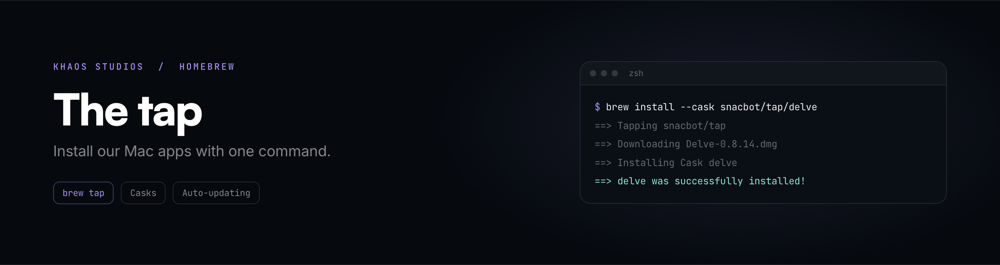

<div align="center">

<a href="https://khaosstudio.com">
  
</a>

<br>

[](Casks)
[](#casks)
[](https://khaosstudio.com/delve/specs/)

Homebrew casks for [Khaos Studios](https://khaosstudio.com) apps.

</div>

---

## Install

```sh
brew install --cask snacbot/tap/delve
brew install --cask snacbot/tap/lantern
```

Homebrew adds the tap for you on first use, so there's no separate `brew tap` step.

## Casks

| Cask | App | Requires |
| --- | --- | --- |
| [`delve`](Casks/delve.rb) | **[Delve](https://khaosstudio.com/delve/)**, a disk space analyzer that maps your drive as one interactive treemap | macOS 12+, Apple Silicon |
| [`lantern`](Casks/lantern.rb) | **[Lantern](https://khaosstudio.com/lantern/)**, monitor brightness control across your local network | macOS 13+, Apple Silicon or Intel |

Use the full `snacbot/tap/lantern` name: Homebrew’s unqualified `lantern` cask is a different app. Both apps install `Lantern.app`, so they cannot share the same applications folder.

Lantern ships from [snacbot/lantern-releases](https://github.com/snacbot/lantern-releases). Its current Mac release is a signed, notarized preview.

Delve ships from [snacbot/delve-releases](https://github.com/snacbot/delve-releases). Delve’s macOS requirement is separate from [Homebrew’s supported macOS versions](https://docs.brew.sh/Installation#macos-requirements). If Homebrew does not support your setup, use the [direct Mac download](https://khaosstudio.com/delve/download/Delve.dmg). Everything else we make lives at [khaosstudio.com](https://khaosstudio.com).

## Updates and removal

Lantern and Delve include Sparkle automatic updates. Homebrew marks both casks
`auto_updates true`; fresh installs use the version in this tap. To ask Homebrew
to check apps with their own updater too:

```sh
brew update
brew upgrade --cask --greedy snacbot/tap/lantern
```

Already installed Lantern manually? Quit it and let Homebrew adopt the matching app:

```sh
brew install --cask --adopt snacbot/tap/lantern
```

Remove the app with `brew uninstall --cask snacbot/tap/lantern`. Settings are
preserved. Add `--zap` only if you also want to delete Lantern’s saved settings,
presets and pairing data.

## Automatic Lantern release updates

The [public release repository’s workflow](https://github.com/snacbot/lantern-releases/actions/workflows/update-homebrew.yml)
runs when a Mac release is published or edited, when `appcast.xml` changes on
`main`, and on manual dispatch. It selects the highest build in the public Mac
feed, confirms the matching `mac-vVERSION` release is published, downloads the
immutable `Lantern-VERSION.dmg`, and verifies its size and SHA-256 against GitHub
and the feed before committing the cask version and checksum here.

Published Mac previews are supported. Drafts, Windows releases, unexpected URLs,
checksum changes to existing versions, and downgrades cannot update the cask.
Publishing the release before the feed is fine: the subsequent feed push triggers
the sync again. No commit is made when the cask is current. Failed validation
leaves the cask unchanged and appears in the workflow’s logs.

The release repository stores `HOMEBREW_TAP_DEPLOY_KEY`, a write-enabled SSH deploy
key scoped only to this tap. It grants no access to application source or other
repositories. To rotate it, replace the tap deploy key and the release repository
secret together. To resync, run **Update Lantern Homebrew cask** from the release
repository’s Actions page.

Updater checks:

```sh
python3 -m unittest discover -s scripts -p 'test_*.py'
python3 scripts/update_lantern.py
brew style --cask snacbot/tap/lantern
brew audit --cask --online snacbot/tap/lantern
brew fetch --cask snacbot/tap/lantern
```

Delve’s cask is maintained separately: bump `Casks/delve.rb` to the published
version and SHA-256 of its immutable release DMG, then verify with Homebrew.

## Why a tap and not homebrew-cask core

homebrew-cask has a [notability requirement](https://docs.brew.sh/Acceptable-Casks) for new submissions. Once Delve clears it, this same cask file goes upstream and the tap gets retired.

## Links

[Khaos Studios](https://khaosstudio.com)
&nbsp;·&nbsp;
[Delve](https://khaosstudio.com/delve/)
&nbsp;·&nbsp;
[Lantern](https://khaosstudio.com/lantern/)
&nbsp;·&nbsp;
[Discord](https://discord.gg/UxfhSWavbQ)
&nbsp;·&nbsp;
[Privacy](https://khaosstudio.com/privacy.html)
